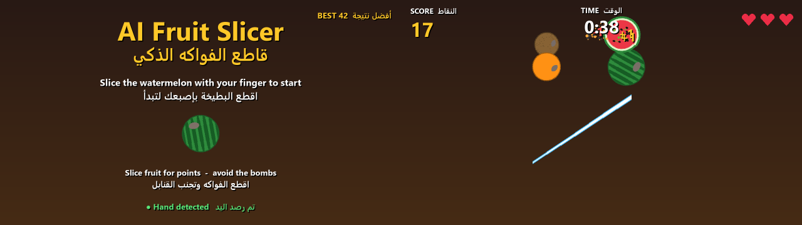

# AI Fruit Slicer — قاطع الفواكه الذكي

A gesture-controlled fruit-slicing game: the webcam tracks your index finger with MediaPipe, and your finger becomes a blade.
لعبة تفاعلية لتقطيع الفواكه بإشارات اليد باستخدام الذكاء الاصطناعي.

Student project for the 2026 innovation fair.


*Menu (left) and a round in play (right). In the real game your mirrored camera image is the background.*

## Status
Playable. Tested on Windows 11 with a laptop webcam: hand tracking runs at ~28 fps and the game holds 60 fps.

## How it works
```
Webcam -> MediaPipe Hands -> index fingertip (landmark 8) -> fast finger moves become blade cuts -> Pygame game -> score
```
- **Fruit** (watermelon, orange, apple, kiwi, lemon) are thrown up at random: slicing one is **+1 point**.
- **Bombs** (red ring, lit fuse): slicing one **costs a heart**. There are 3 hearts.
- **Timer**: 60 s per round, and fruit come faster as the round goes on.
- Missed fruit cost nothing, which keeps it friendly for first-time players.
- Slice the watermelon to start or to play again, so visitors never need the keyboard.
- All images and sounds are generated in code (`fruit_slicer/assets.py`), so there are no asset licences to worry about.

## Run
Needs Python 3.10–3.12 (MediaPipe 0.10.21 has no 3.13+ wheels) and a webcam.
```bash
uv venv --python 3.12 .venv
uv pip install --python .venv/Scripts/python.exe -e ".[dev]"
.venv/Scripts/python.exe -m fruit_slicer              # windowed
.venv/Scripts/python.exe -m fruit_slicer --fullscreen # for the fair
```
Options: `--camera 1` (another webcam), `--duration 90` (round length in seconds).

| Key | Action |
|---|---|
| `F` | toggle fullscreen |
| `Space` | start / restart without slicing |
| `Esc` | quit |
| Mouse (hold left button) | backup blade if the camera fails |

## Tips for the fair
- Use good front lighting and a plain background, and stand 1–2 m from the camera.
- Swipe fast: slow finger movements don't cut, so pointing at the screen won't slice things by accident.
- The best score is saved in `best_score.json`. Delete that file to reset it for a new day.

## Code
| File | Job |
|---|---|
| `fruit_slicer/logic.py` | physics, slice detection, round rules (pure, unit-tested) |
| `fruit_slicer/tracker.py` | webcam + MediaPipe on a background thread |
| `fruit_slicer/assets.py` | fruit/bomb images, Arabic+English text, sound effects |
| `fruit_slicer/game.py` | game loop, scenes (menu / play / game over), drawing |
| `tests/test_logic.py` | `python -m pytest` |

## Pinned versions
Python 3.12 · mediapipe 0.10.21 · opencv-python 4.11.0.86 · numpy 1.26.4 · pygame 2.6.1 · arabic-reshaper 3.0.0 · python-bidi 0.6.6

## License
[MIT](LICENSE) © 2026 Hamza Alqaruoti. Uses [MediaPipe](https://github.com/google-ai-edge/mediapipe) (Apache-2.0) and [pygame](https://www.pygame.org) (LGPL).
